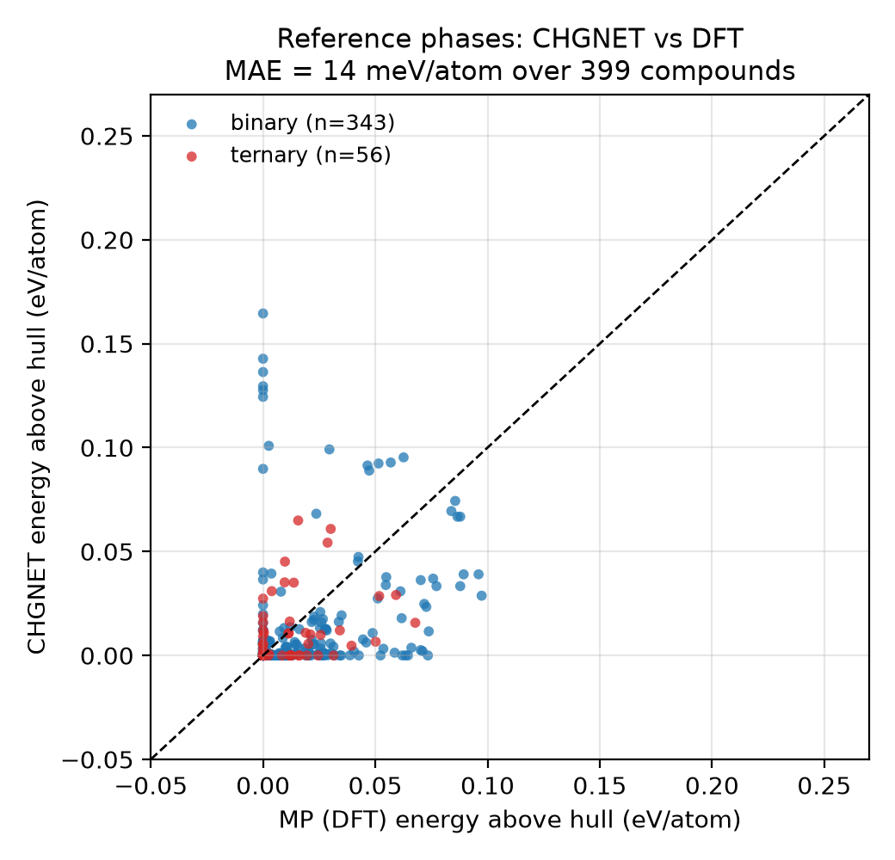

# Budgeted Discovery Agent for Li-halide solid electrolytes

**OSI Hackathon 2026.** An agent that decides *which candidate materials are worth simulating* under a fixed
budget, in the family of lithium halide solid electrolytes (Li3YCl6, Li3InCl6, Li2ZrCl6 types).

Each candidate is relaxed with a universal ML interatomic potential (**CHGNet**) and scored by its energy above
a convex hull built from Materials Project reference phases **re-relaxed with the same potential**. We race an
**LLM agent with feedback** against **random search**, a **data-mined substitution baseline**
(pymatgen `SubstitutionProbability`, Hautier et al.), an **ionic-radius heuristic** and **GP Bayesian
optimisation**, then cross-check the best new candidates with a second potential (**MACE-MP-0**) and against
databases (Materials Project, GNoME, Alexandria, OQMD, JARVIS) and the literature.

## Live demo

**https://vignesh-82505--osi-discovery-agent-notebook.us-east.modal.run**

The marimo notebook served from Modal in app mode (no install, no code editing). Besides the results, it has:

* **8. Playground**: change the hit threshold, budget, batch size, strategies, seeds and the skip-found rule,
  then re-run the race; campaigns replay over the cached CHGNet results in seconds.
* **9. LLM copilot, live**: pick a model (gpt-4.1-mini or gpt-5-mini) and prompt, press *Suggest next batch*, and
  the agent chooses candidates with a reason for each before the CHGNet result is revealed, round by round,
  next to the random-search expectation. Live calls are cached and capped per server
  (`PLAYGROUND_LLM_CALL_CAP`, default 300). The first visit after an idle period takes a few seconds to wake.

Redeploy after changes with `modal deploy modal_app.py`.

## Results (budget 90 simulations, pool 236 candidates / 123 compositions)


| strategy | seeds | stable compositions found | novel stable found | known rediscovered | speed-up vs random (stable / novel) |
|---|---|---|---|---|---|
| **GP-BO** (P(hit) acquisition) | 5 | **65.8 ± 4.6** | **56.6 ± 2.8** | 5.8 | **1.5x / 1.7x** |
| LLM + GP hybrid (gpt-5-mini) | 3 | 58.0 ± 16.5 | 42.0 ± 18.5 | 11.0 | 1.3x / 1.3x |
| LLM agent, reasoning model (gpt-5-mini) | 3 | 54.3 ± 3.9 | 37.7 ± 4.7 | 11.0 | 1.3x / 1.1x |
| Ionic-radius heuristic | 10 | 49.0 | 39.0 | 6.0 | 1.1x / 1.2x |
| Data-mined substitution (Hautier) | 10 | 48.0 | 39.0 | 6.0 | 1.1x / 1.2x |
| LLM agent (gpt-4.1-mini) | 3 | 43.7 ± 1.7 | 29.0 ± 2.8 | 10.3 | 1.0x / 0.9x |
| LLM, brief's basic prompt (ablation) | 3 | 41.0 ± 2.9 | 25.3 ± 4.0 | 11.0 | 0.9x / 0.8x |
| Random | 10 | 43.2 ± 2.9 | 33.1 ± 2.8 | 6.2 | 1.0x / 1.0x |

Pool totals at the headline threshold: 84 stable compositions, 65 of them novel, 13 experimentally known.
Speed-up = simulations random needs to match the strategy's count at the budget ÷ budget (random was run over the
whole pool, so this is measured, not extrapolated). All numbers, plus thresholds 0.03 and 0.05 eV/atom and the
brief's AF50 metric, are in `results/summary.json`.

**What we found**

* **A GP surrogate wins the novel-discovery race**: 1.7x fewer simulations than random to reach the same number
  of novel stable compositions, ahead of the ICSD substitution baseline (1.2x).
* **LLM agents are the best at rediscovery** (10-11 of 13 known compounds vs 6 for random): the literature prior
  helps them find known phases but pulls them away from novel chemistry, so on novel hits a small model
  (gpt-4.1-mini) is no better than random. A reasoning model (gpt-5-mini) learns the trends from feedback
  (1.3x on all stable compositions; see its reasons in `results/campaign_picks.csv`), and an LLM + GP hybrid is
  the strongest LLM arm (1.3x / 1.3x), with high seed variance.
* **15 new candidates cross-checked**: all 15 top novel hits (diversified, at most 3 per metal) stay within
  0.05 eV/atom of the hull with MACE-MP-0 too (`results/top_candidates.csv`). Leading ones: Li3Ho0.5Yb0.5Cl6,
  Li3Yb0.5Dy0.5Cl6, Li3Dy0.5Lu0.5Cl6, Li3Lu0.5Ho0.5Cl6, Li3LuCl4Br2 (on or below the hull with both potentials).

## Opening up both AIs in the loop

Three additions that combine our team's other projects with this one:

* **The LLM's edge is memory, in two domains.** On real reaction-yield screens (our benchmark
  [osihackiitd](https://github.com/bruce249/osihackiitd); Buchwald-Hartwig, Ahneman et al. 2018) the LLM agent reaches
  0.84 of the best yield after 10 experiments with chemical names shown, 0.74 with names hidden, 0.74 for random.
  Here, LLM agents rediscover the most known compounds but are 0.8-1.1x random on new ones
  (`src/cross_domain.py`, `results/fig5_cross_domain.png`; source data in `external/osihackiitd/`).
* **Reading the simulator's mind** (`src/latent.py`, protocol from our MACE-MP-0 interpretability study
  [osi-draft](https://github.com/lntick/osi-draft)). One MACE-MP-0 forward pass on the *unrelaxed* structure; ridge
  probe on Li / metal / halide-averaged invariant features, splits grouped by chemistry (105 groups):

  | probe reads | median R² | rank corr. | AUC (stable) |
  |---|---|---|---|
  | MACE-MP-0, trained | **0.67** | **0.85** | **0.92** |
  | same network, scrambled weights | 0.41 | 0.80 | 0.90 |
  | Magpie composition features | -2.71 | 0.72 | 0.84 |
  | shuffled labels | -0.02 | -0.06 | 0.49 |

  A GP searching in that latent space (`gp_latent`, PCA-20, no labels) found **69.2 ± 5.7 stable compositions, the
  most of any arm** (GP-BO 65.8, scrambled-weight control 60.0), reached half of the novel ones fastest (AF50 1.85x)
  and ties GP-BO on novel at the budget (55.8 vs 56.6).
* **Where, whether it matters, and what it means** (`src/interp.py`, `results/fig4_interp.png`):
  stability is most decodable after MACE's first layer (rank corr. 0.86 vs 0.76 after layer 2); training matters most
  on Li and halide sites (0.78-0.80 trained vs 0.54-0.62 scrambled), metal sites rank well even untrained. Causal test:
  erasing 10 linear stability directions (INLP) drops the probe AUC 0.92 → 0.40 (10 random directions: 0.92) and the
  latent GP from 69.2 to 61.2 stable compositions (random erasure 64.4; seed spread ±5, so consistent, not conclusive).
  Textbook descriptors (metal radius, electronegativity, Br fraction, volume, stoichiometry) explain 42% of the probe's
  score.
* **Same network, second property** ([osi-draft](https://github.com/lntick/osi-draft), results in
  `external/osi-draft/`): trained only on energies, MACE-MP-0 features predict high-spin Fe magnetic moments (Fe²⁺ vs
  Fe³⁺) on unseen chemical systems, R² 0.75 vs 0.19 for geometry and 0.06 for scrambled weights; charge balance alone
  gives 0.49 and MACE adds 0.23 on top of geometry + charge balance. Ablating the Fe probe direction moves energies no
  more than random directions: present is not the same as used, as in our erasure test.
* **Dynamic stability** (`src/phonons.py`, tiers from our [Lattice](https://github.com/dbajaj123/lattice-materials-discovery)
  studio): CHGNet + phonopy finite displacements for the top 15: 2 free of imaginary modes (Li3YbBr6,
  Li3Yb0.5Dy0.5Cl6), 12 with soft framework modes (-0.2 to -0.75 THz; Li carries 0-24% of them while being 30% of the
  atoms), 1 unstable (Li2ZrBr6, -2.8 THz).

**Validation (Figure 2).** CHGNet vs DFT energy above hull over 399 MP reference compounds: MAE 14 meV/atom; every
DFT-stable ternary lands within 0.03 eV/atom (go/no-go passed). MACE-MP-0: MAE 21 meV/atom over 104 compounds.



## Decisions that differ from the brief (and why)

* **Hit threshold e_hull ≤ 0, not 0.03 eV/atom.** Li3MX6 halides sit within a few meV/atom of LiX + MX3: at 0.03,
  92% of the candidates (116 of 123 compositions) are hits and no strategy can be distinguished from random. At 0 the base
  rate is 68% of compositions. Results at 0.03 and 0.05 are still reported.
* **Two prototypes come from analogues.** Materials Project has no Li3YCl6 and no Li2ZrCl6 entry. `prototypes.py`
  then takes the lowest-e_hull isostructural analogue (wildcard formula search, same crystal system) and
  substitutes the metal back: Li3ErCl6 (P321, mp-676361) for Li3YCl6-type, Li2UCl6 (P-31m, mp-676749) for
  Li2ZrCl6-type. Li3InCl6 is MP's lowest polymorph (C2, 60 atoms).
* **"Known" also uses the literature.** MP flags every Li3MCl6 / Li2MCl6 entry as theoretical (the experimental
  structures are disordered), so the MP flag alone finds almost no rediscovery targets. Known = MP experimental
  OR the exact formula appears in a paper title/abstract.
* **Composition counting and campaign rule.** A composition counts once, however many prototypes are evaluated,
  and every strategy drops compositions its own history already shows as stable.
* **GP-BO acquisition = P(e_hull ≤ threshold).** The brief's expected improvement chases the single lowest value
  and over-explored here (0.7x random); P(hit) is the greedy choice for "maximise the number of hits". `ei` remains
  selectable in `config.yaml`.
* **Extra LLM arms.** The brief's prompt is kept as an ablation (`llm_basic`); the main prompt states the scoring
  rule and energy scale and feeds back the competing phases; a reasoning model and an LLM + GP hybrid (brief §5.4)
  are added. Every arm is reported.
* **Novelty sources.** The Alexandria OPTIMADE server was unreachable during the run (reported as "unchecked",
  never "absent"); OQMD was intermittently down; JARVIS was checked against its full figshare `dft_3d` dataset;
  GNoME via the MP API. Literature: OpenAlex, arXiv, Semantic Scholar (Valency MCP was not available in our
  harness).

## Pool and compute

* Pool: 236 candidates (A 88, B 10, C 48, D 90), 374 orderings, 123 compositions; 513 reference phases from 105
  chemical systems (11 skipped for > 80 atoms).
* CHGNet 0.4.2: 886 relaxations, all converged, mean 6.4 s each on 2 vCPU; 3.4 min wall-clock fanned out over up
  to 80 Modal containers. MACE-MP-0 medium (mace-torch 0.3.16): 211 relaxations.
* LLM calls: 27 per arm (3 seeds x 9 rounds), all prompts and responses cached in `data/cache/llm/`.
* Seeds: random/substitution/radius 10, GP-BO 5, LLM arms 3; candidate orderings seed 42 (`config.yaml`).

## Platforms used

Materials Project (mp-api), CHGNet, MACE-MP-0, OPTIMADE (MP, Alexandria, OQMD, JARVIS), JARVIS-Tools, OpenAlex,
arXiv, Semantic Scholar, OpenAI (gpt-4.1-mini, gpt-5-mini), Modal (compute), marimo (notebook).

## Limitations

* ML potentials approximate DFT; stability margins here (a few meV/atom) are comparable to their error, so every
  candidate needs DFT and experimental confirmation.
* Yb compounds are the most stable with CHGNet but much less so with MACE; Yb reference energies are known to be
  delicate in MP-trained models. Li2CeX6 requires Ce4+, which may not survive.
* Many real halide electrolytes are partly disordered; we evaluate ordered approximants (≤ 2 orderings, ≤ 80 atoms)
  and keep the lowest-energy one.
* Thermodynamic stability is necessary but not sufficient; ionic conductivity and the electrochemical window were
  not computed.
* Campaigns replay precomputed evaluations (standard benchmarking practice).
* The LLM's rediscovery advantage may come from memorised literature; novel hits are the fair comparison.

## Video outline (4 min)

* **0:00-0:30** Solid electrolytes; the search space is large and simulation is costly, so deciding what to
  simulate is the problem.
* **0:30-1:30** The loop (strategy → CHGNet → same-model hull → feedback) and the strategies; one reasoning example
  from gpt-5-mini, e.g. *"Ordered mixtures of heavy lanthanides gave consistently strong stability (e.g. Yb/Er,
  Yb/Dy), so Li3Tm0.5Yb0.5Cl6 is likely to be a stable trigonal solid solution."*
* **1:30-2:45** Figure 1: GP-BO 1.7x random on novel hits; LLMs best at rediscovery but anchored on known chemistry;
  then the candidates table.
* **2:45-3:30** Why we trust it: same-model hull, parity plot (14 meV/atom), MACE agreement 15/15, database and
  literature checks.
* **3:30-4:00** Next: DFT confirmation of the top candidates, ionic-conductivity screening, synthesis.

## How to reproduce

All computation runs on [Modal](https://modal.com); nothing heavy runs locally.

```bash
pip install modal && modal setup            # once
cp .env.example .env                         # put MP_API_KEY in it
modal secret create openai-secret OPENAI_API_KEY=sk-...   # LLM key (or set LLM_API_KEY in .env)
bash run_pipeline.sh                         # every step caches to the Modal volume; safe to re-run
```

`run_pipeline.sh` runs, in order:

| step | module | output |
|---|---|---|
| API checks + timing | `modal_app.py::smoke` | `results/smoke.json` |
| prototypes by formula (no hardcoded MP ids) | `src/prototypes.py` | `data/cache/prototypes.json` |
| candidate pool | `src/candidates.py` | `data/cache/candidates.json` |
| MP reference phases, one call per chemical system | `src/mp_fetch.py` | `data/cache/references.json`, `mp_index.json` |
| CHGNet relaxations (fan-out over Modal containers) | `modal_app.py::relax_batch`, `src/mlip.py` | `data/cache/mlip/chgnet/*.json` |
| MLIP hulls + validation | `src/hull.py` | `results/evaluations_chgnet.json`, `validation_chgnet.json`, `fig2_parity.png` |
| database + literature novelty | `src/novelty.py` | `data/cache/novelty.json` |
| hidden labels | `src/labels.py` | `results/labels.csv` |
| campaigns (all strategies, all seeds) | `src/campaign.py` | `results/campaign_log.csv`, `campaign_picks.csv`, `summary.json` |
| MACE cross-check | `src/second_model.py` | `results/second_model.json`, `fig2_parity_mace.png` |
| figures + final table | `src/report.py` | `results/fig1_discovery.png`, `top_candidates.csv` |

Then view the deliverable notebook, which only reads cached files:

```bash
pip install marimo pandas pymatgen
marimo run notebook.py
```

Configuration (budget, batch, seeds, thresholds, element lists, model names, timeouts) lives in `config.yaml`.
Secrets come only from environment variables (`MP_API_KEY`, `LLM_API_KEY`/`OPENAI_API_KEY`, optional
`LLM_BASE_URL`, `LLM_MODEL`).
