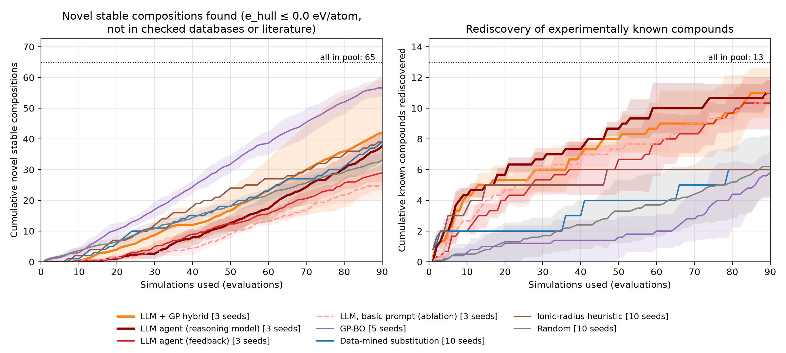

# Budgeted Discovery Agent: which Li-halide solid electrolytes are worth simulating?

Team: [add names] · OSI Hackathon 2026 · code: github.com/bruce249/osi-discovery-agent · video: [video link]

## Problem

Li3MX6 / Li2MX6 halide solid electrolytes; 236 candidates, 123 compositions; each costs a simulation, so the decision of what to simulate matters.

## Method

Strategy proposes 10 → CHGNet relaxation → same-model convex hull (MP references) → e_hull feedback → repeat until the budget is spent. Labels stay hidden from strategies.

Validation: MAE 14 meV/atom vs DFT over 399 reference compounds.

## Result

With 90 simulations from a pool of 236 candidates (65 novel stable compositions hidden in it), GP-BO found the most novel stable compositions, 56.6 ± 2.8 versus 33.1 ± 2.8 for random: random search needs 1.7x as many simulations to match it (1.5x on all stable compositions), and the data-mined substitution baseline reaches 1.2x.

| strategy (@90 sims) | stable found | novel found | known rediscovered | acceleration vs random (novel) |
|---|---|---|---|---|
| GP on MACE latent | 69.2 ± 5.7 | 55.8 ± 6.0 | 9.0 ± 2.1 | 1.7 |
| GP-BO | 65.8 ± 4.6 | 56.6 ± 2.8 | 5.8 ± 1.5 | 1.7 |
| GP on scrambled-MACE latent | 60.0 ± 6.4 | 48.6 ± 5.2 | 6.8 ± 1.2 | 1.5 |
| LLM + GP hybrid | 58.0 ± 16.5 | 42.0 ± 18.5 | 11.0 ± 1.6 | 1.3 |
| LLM agent (reasoning model) | 54.3 ± 3.9 | 37.7 ± 4.7 | 11.0 ± 0.8 | 1.1 |
| LLM agent | 43.7 ± 1.7 | 29.0 ± 2.8 | 10.3 ± 1.7 | 0.9 |
| LLM, basic prompt | 41.0 ± 2.9 | 25.3 ± 4.0 | 11.0 ± 0.8 | 0.8 |
| Data-mined substitution | 48.0 ± 0.0 | 39.0 ± 0.0 | 6.0 ± 0.0 | 1.2 |
| Ionic-radius heuristic | 49.0 ± 0.0 | 39.0 ± 0.0 | 6.0 ± 0.0 | 1.2 |
| Random | 43.2 ± 2.9 | 33.1 ± 2.8 | 6.2 ± 2.0 | 1.0 |

## Opening up both AIs in the loop

The LLM's edge is memory. On real reaction-yield screens (our team's benchmark, github.com/bruce249/osihackiitd; Buchwald-Hartwig, Ahneman et al. 2018, 5 substrates) the LLM agent reached 0.84 of the best possible yield after 10 experiments with chemical names shown, 0.74 with names hidden and 0.74 for random. Here, LLM agents alone rediscover the most known compounds but are only 0.8-1.1x random on new ones: in both domains the advantage is prior knowledge, not search. Reading the simulator's mind. With the probing protocol of our MACE interpretability study (linear probes, scrambled-weight control, splits grouped by chemistry), MACE-MP-0 features of the unrelaxed candidates predict their post-relaxation stability on unseen chemistries: rank correlation 0.85, AUC 0.92, R² 0.67, vs 0.80 / 0.90 / 0.41 for the same network with scrambled weights and 0.72 / 0.84 for Magpie composition features (shuffled labels: AUC 0.49). A GP searching in this latent space found 69.2 stable compositions, the most of any arm, and reached half of the novel ones 1.85x faster than random; the scrambled control found 60.0. Dynamic stability. Finite-displacement phonons (CHGNet + phonopy; tiers from our Lattice studio) for the top candidates: 2/15 free of imaginary modes, 12 with soft modes between -1 and -0.1 THz (framework tilts: Li carries only 0%-24% of them while being 30% of the atoms; they need larger supercells or DFT) and 1 unstable (Li2ZrBr6, -2.8 THz, flagged).

## New candidates (15/15 agreed by MACE-MP-0)

| formula | prototype | CHGNet e_hull | MACE e_hull | agreed | databases | literature |
|---|---|---|---|---|---|---|
| Li2CeBr6 | Li2ZrCl6-type | -0.133 | -0.032 | yes | absent (unchecked: Alexandria) | none found |
| Li3YbBr6 | Li3InCl6-type | -0.070 | -0.003 | yes | absent (unchecked: Alexandria) | none found |
| Li3Ho0.5Yb0.5Cl6 | Li3InCl6-type | -0.060 | -0.037 | yes | absent (unchecked: Alexandria, OQMD) | none found |

## Validation and limitations

ML potentials approximate DFT (CHGNet reference MAE 14 meV/atom; MACE 21 meV/atom); stability margins here are a few meV/atom, comparable to that error, so hits are predictions, not proof. Yb compounds come out most stable with CHGNet but much less so with MACE (Yb reference energies are known to be delicate in MP-trained models); Li2CeX6 needs Ce4+, which is not guaranteed to survive. Ordered approximants of partly disordered phases; 0 K thermodynamics only (no ionic conductivity or electrochemical window); campaigns replay precomputed evaluations. The brief's 0.03 eV/atom hit threshold makes 92% of the pool 'hits', so we used e_hull <= 0 (0.03/0.05 in summary.json). *'Novel' = not found in MP, GNoME, JARVIS, OQMD (partly reachable) and literature searches; the Alexandria server was unreachable during the run and is reported as unchecked.
